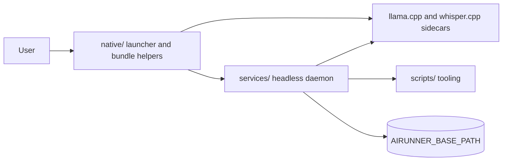

# Layered Product Architecture

This note describes the current AIRunner package layout and the intended
ownership boundaries between the split packages.

> Retired GUI: the `src/` desktop client was removed (2026-10-25). Any
> `src/`/`GUI` node below is historical; the supported path is
> `native/` launcher -> `services/` headless daemon.

## Current Package Map

## Package Responsibilities

| Package | Owns | Does not own |
|---------|------|--------------|
| `services/` | daemon entry points, FastAPI server, WebSocket endpoints, runtime registry, downloads, persistence, migrations, domain state routes, modality orchestration, and the canonical daemon HTTP client | desktop-only widget behavior and client-local preferences |
| `src/` (removed 2026-10-25) | formerly: desktop app, GUI widgets, GUI workflow surfaces | n/a (historical row) |
| `native/` | Python launcher entry point, runtime layout helpers, startup environment configuration, and sidecar build integration | modality orchestration and GUI widget logic |
| `scripts/` | developer tooling: test runner, UI build, install helpers, and quality reports | runtime product behavior |

The top-level `api/` and `model/` packages from earlier split-plan documents
no longer exist. Shared runtime contracts and enums live in
`airunner_services.contract_enums`, and the canonical daemon client lives in
`airunner_services.daemon_client`.

## Runtime Paths

### Desktop path (retired with `src/` removal, 2026-10-25)

1. `native/` launches the packaged or checkout application.
2. ~~`src/` renders the GUI~~ (removed; use the headless path below).
3. `services/` owns the headless daemon, runtime routing, and service-backed state operations such as `/api/v1/state/<domain>/<ModelName>`.
4. Native sidecars such as `llama.cpp` and `whisper.cpp` are supervised
   from the daemon path.

### Headless path

1. `services/` starts the daemon directly.
2. `services/` owns the daemon HTTP/WebSocket surface directly.
3. Optional sidecars are launched through the runtime registry.

### Installed product path

1. `native/` provides the launcher entry point and bundle layout helpers.
2. `services/` is installed as a Python package (`src/` removed 2026-10-25).
3. The launcher resolves the runtime layout and bundled sidecars.

## Transitional Boundaries

The split is real, but not fully complete yet.

- (Historical, pre-`src/`-removal: helpers once straddled `services/`
  and `src/`, with GUI-to-daemon handoff code in `src/`.)
- The old generic model bridge and GUI-side database bootstrap have been
   removed in favor of domain-scoped daemon state clients.

That transitional state is acceptable as long as new work respects the
target boundaries above rather than moving more ownership back into the
wrong layer.

## Validation Surface

AIRunner uses a mixed validation strategy:

- package-local unit or smoke coverage for focused changes
- daemon runtime smoke commands from `scripts/run_tests.py`
- real daemon-backed end-to-end suites under `services/tests/`

The validation matrix for each package lives in
[package_split_contract.md](package_split_contract.md).
