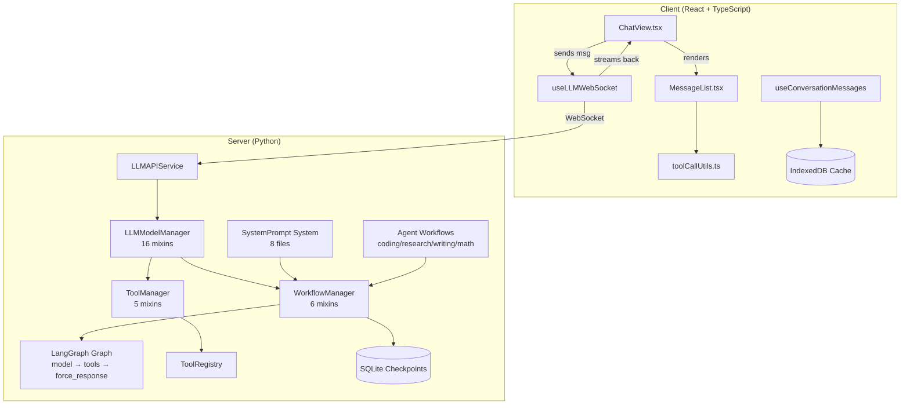
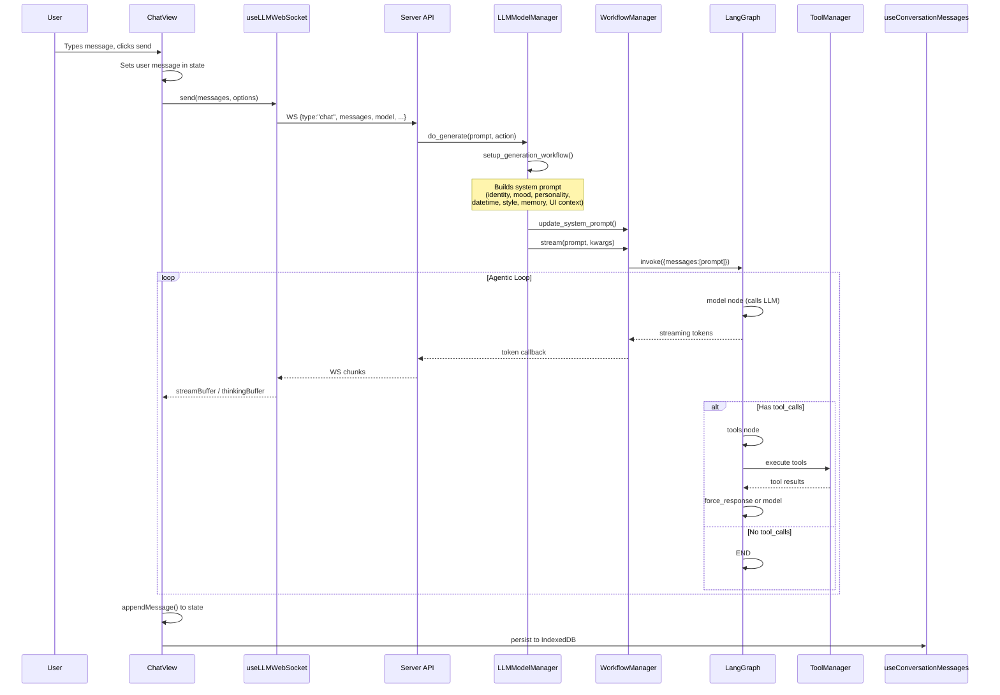
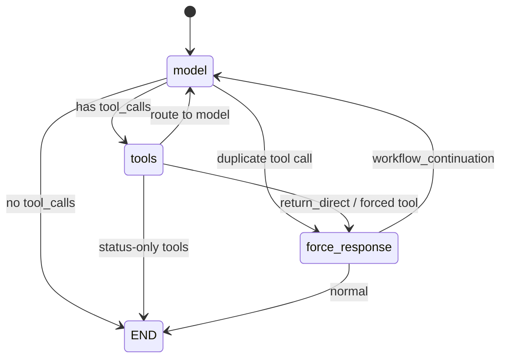
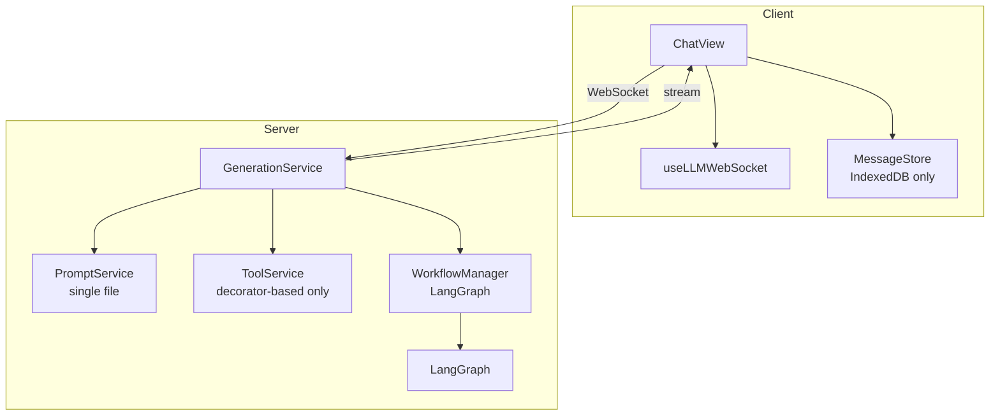

# AIRunner LLM Agent Architecture Audit

## 1. Executive Summary

The AIRunner LLM agent is a sophisticated chatbot system with tool-calling, structured workflows, mood/personality, thinking display, and multi-modal capabilities. The architecture follows a **client-server model with WebSocket streaming** and uses **LangGraph** for agentic orchestration on the server side. While the system is functional, significant **over-engineering, redundancy, and inconsistency** exist across both sides.

---

## 2. High-Level Architecture



---

## 3. The Full Request Flow



---

## 4. Server-Side Architecture Deep Dive

### 4.1 LLMModelManager — The God Object

[`LLMModelManager`](server/src/airunner_services/model_management/llm_model_manager.py:47) is the central orchestrator. It inherits from **18 mixins**:

| Mixin | Purpose |
|---|---|
| `BaseModelManager` | Core model lifecycle |
| `BatchProcessingMixin` | Batch inference |
| `ComponentLoaderMixin` | Load/setup components |
| `ConversationManagementMixin` | Conversation CRUD |
| `GenerationMixin` | LLM text generation |
| `ModelAvailabilityMixin` | Model availability checks |
| `ModelLoaderMixin` | Model loading/unloading |
| `PropertyMixin` | Property access |
| `QuantizationConfigMixin` | Quantization configuration |
| `RequestHandlingMixin` | Request handling |
| `SpecializedModelMixin` | Specialized models |
| `StatusManagementMixin` | Model status tracking |
| `SystemPromptMixin` | System prompt generation |
| `TokenizerLoaderMixin` | Tokenizer loading |
| `ToolClassificationMixin` | Tool routing/classification |
| `ToolFilteringMixin` | Tool filtering |
| `ValidationMixin` | Request validation |
| `RAGMixin` | RAG capabilities |
| `QuantizationMixin` | Quantization methods |

**Issue: God Object Anti-pattern.** 19 mixins is excessive. Many could be composed into focused service objects — particularly `ConversationManagementMixin`, `SystemPromptMixin`, and `ToolClassificationMixin`.

### 4.2 WorkflowManager — The LangGraph Runner

[`WorkflowManager`](server/src/airunner_services/llm/workflow_manager.py:47) wraps LangGraph with 6 mixins:

| Mixin | Purpose |
|---|---|
| `ToolManagementMixin` | Tool binding/unbinding |
| `ToolExecutionMixin` | Tool execution with status signals |
| `WorkflowBuildingMixin` | Graph construction |
| `SystemPromptMixin` | System prompt |
| `NodeFunctionsMixin` | LangGraph node implementations |
| `StreamingMixin` | Token streaming |

#### LangGraph Graph Structure



**Routing Decision Logic** in [`RoutePolicy`](server/src/airunner_services/llm/managers/route_policy.py:13):

1. `after_model()`: If AIMessage has `tool_calls` → route to `tools` unless duplicate → `force_response`. Otherwise `END`.
2. `after_tools()`: For each tool call, check `NO_RESPONSE_TOOLS` (skip), `return_direct` → `force_response`, forced tool completed → `force_response`. Default → `model`.
3. `after_force_response()`: If `workflow_continuation` → back to `model`, else `END`.

### 4.3 System Prompt Assembly — 8 Files Deep

The system prompt is assembled across **8 files** with significant indirection:

```
SystemPromptMixin
  ├── system_prompt_mixin.py (facade)
  ├── system_prompt_actions.py (action-specific prompts)
  ├── system_prompt_action_text.py (ACTION_MODE_PROMPTS dictionary)
  ├── system_prompt_context.py (base prompt parts builder)
  ├── system_prompt_mood.py (mood section)
  ├── system_prompt_text.py (static text blocks)
  └── // also pulls from agents/workflow_prompts.py
```

The final prompt includes:
1. **Identity**: "You are {botname}, a helpful AI assistant."
2. **Personality**: `chatbot.personality` (only for CHAT/APPLICATION_COMMAND)
3. **Datetime**: Current date/time (for CHAT, APP_COMMAND, DEEP_RESEARCH)
4. **Mood section**: Current mood/emoji + behavior guidance (if `use_chatbot_mood` enabled)
5. **Style guidelines**: Warm, empathetic, varied sentences
6. **Memory instructions**: `record_knowledge` rules
7. **Health disclaimer**: Medical disclaimer
8. **Workflow instructions**: If a workflow is active
9. **Action-specific prompt**: Math, Precision, or conversational
10. **Force-tool instruction**: If a specific tool is forced

### 4.4 Tool Management — Dual System

Tools are managed through **two parallel systems**:

1. **`ToolRegistry`** ([`core/tool_registry.py`](server/src/airunner_services/llm/core/tool_registry.py:110)): Decorator-based registration with categories, metadata, deferred loading.
2. **`ToolManager`** ([`tool_manager.py`](server/src/airunner_services/llm/tool_manager.py:22)): 5 mixins that create LangChain `@tool` functions by wrapping registry-registered functions.

**Registered tools** (~30+ tools across 16 categories):

| Category | Tools |
|---|---|
| KNOWLEDGE | record, recall, read_file, list_files, delete, update |
| CONVERSATION | list, get, summarize, update_title, switch, create, search, delete, clear |
| MOOD | update_mood |
| RESEARCH | search_web, search_news, scrape_website |
| MATH | sympy_compute, numpy_compute, python_compute, polya_reasoning |
| SYSTEM | get_application_state, schedule_task, set_application_mode, monitor_system_health, etc. |
| WORKFLOW | start_workflow, transition_phase, add_todo_item, start_todo_item, etc. |
| FILE | read_file, write_file, list_files |
| IMAGE | generate_image |

### 4.5 Agent Workflow System — Partially Redundant

The [`agents/`](server/src/airunner_services/llm/agents/) module defines a sophisticated state machine for structured task execution:

- [`WorkflowState`](server/src/airunner_services/llm/agents/workflow_state.py:122) with `workflow_type`, `current_phase`, `todo_list`, `artifacts`
- [`WorkflowDefinition`](server/src/airunner_services/llm/agents/workflow_state.py:90) and `PhaseDefinition` for predefined workflows
- Workflow tools (`start_workflow`, `transition_phase`, `add_todo_item`, etc.)
- Global `_current_workflow_state` singleton

**Issue: This is redundant with LangGraph's built-in state management.** The LangGraph graph already has `WorkflowState` in [`workflow_manager.py`](server/src/airunner_services/llm/workflow_manager.py:39). The agent workflow state machine duplicates langgraph checkpointing and its own TODO/phase tracking on top.

### 4.6 Long-Running / Autonomous System — Over-Engineered

The [`long_running/`](server/src/airunner_services/llm/long_running/) module contains ~50 files for autonomous project execution with features like:
- `HarnessAutonomous` — manages autonomous iteration loops
- `ProjectManager` — feature records, dependency tracking, git operations
- `InitializerAgent` — project initialization, agent generation
- `SessionAgent` — planning, verification, delegation
- `TaskDetector` — pattern-based task detection

This appears to be a **separate, massive subsystem** that overlaps significantly with the workflow state machine and LangGraph. Most of it seems unused or partially integrated.

---

## 5. Client-Side Architecture

### 5.1 ChatView — The Central Component

[`ChatView.tsx`](client/src/components/chat/ChatView.tsx:36) orchestrates:
- 4 tabs (chat, knowledge base, history, LLM settings)
- Message sending via WebSocket
- Message deletion (truncate chain)
- Message editing (truncate + resubmit)
- Drag-and-drop document activation
- TTS playback

**Key flows:**

**Send**: `handleSend` → appends user message → calls `doInference(msgs)` → streams via WebSocket → appends AI response.

**Delete**: `handleDeleteMessage(index)` → `deleteMessagesAfter(convId, index)` in IndexedDB AND HTTP `truncateConversation(convId, index)` to server.

**Edit**: `handleSubmitEdit(index, newContent)` → `messages.slice(0, index)` + edited user msg → `doInference(edited)`.

### 5.2 useLLMWebSocket — Streaming Hook

[`useLLMWebSocket.ts`](client/src/features/llm/useLLMWebSocket.ts:37) manages:
- Persistent WebSocket connection with reconnection
- Message queue during connect
- Generation tracking (stale callback prevention)
- Two types of stream chunks: `thinking` (status: started/streaming/completed) and regular `token`
- Promise-based `send()` that resolves when `done:true` is received

### 5.3 MessageList — Rendering with Tool Call Parsing

[`MessageList.tsx`](client/src/components/chat/MessageList.tsx:13) renders:
- **`MessageBubble`**: Stored messages with optional thinking collapsible (if `thinking_content`), tool call sections (parsed from content XML), edit mode
- **`StreamingBubble`**: Live streaming display with:
  - Thinking section (collapsible, with ✅/🧠 icons)
  - Tool call sections (parsed from `<tool_call>` XML in stream)
  - Partial tool call display (when `<tool_call>` is unclosed)
  - Clean content (tool call XML stripped)

### 5.4 toolCallUtils — XML-Based Tool Call Parsing

[`toolCallUtils.ts`](client/src/components/chat/toolCallUtils.ts:1) parses:
```
<tool_call>
<function=function_name>
<parameter=param_name>
value
</parameter>
</function>
</tool_call>
```

This is a client-side parsing layer for tool calls that are **already parsed on the server** by LangGraph. The server sends tool calls through LangChain's structured `tool_calls` field, but then the LLM may also embed them as XML in the text response. The client parses XML to display them in collapsible widgets.

### 5.5 useConversationMessages — Dual-Source State

[`useConversationMessages.ts`](client/src/hooks/useConversationMessages.ts:37) manages messages with:
- **IndexedDB cache** (instant load)
- **Server fetch** (authoritative)
- `appendMessage()` for individual appends
- `deleteMessagesAfter()` for truncation

**Issue**: Messages are stored in both React state (`useState<Message[]>`) AND IndexedDB. The sync strategy is append-only with ID-based deduplication but there's no conflict resolution when server and cache diverge.

---

## 6. Identified Issues

### 6.1 Architecture Redundancy & Over-Engineering

| # | Issue | Severity |
|---|---|---|
| 1 | **Dual Workflow State Systems**: `agents/workflow_state.py` has its own `WorkflowState`, `WorkflowDefinition`, `TodoItem`, etc. that run parallel to [`workflow_manager.py`](server/src/airunner_services/llm/workflow_manager.py:39)'s `WorkflowState`. The agent system doesn't integrate with LangGraph's state — it uses a global singleton instead. | HIGH |
| 2 | **Long-Running / Autonomous System** (~50 files in `long_running/`) appears to be a separate agentic framework that duplicates much of the workflow graph and tool system. Most of it seems disconnected from the main loop. | HIGH |
| 3 | **LLMModelManager has 19 mixins**. It's a god object that touches model loading, generation, conversation management, tool classification, RAG, and validation. | MEDIUM |
| 4 | **ToolManager has two tool sources**: hardcoded tool builder methods (e.g., `clear_conversation_tool()`, `list_files_tool()`) AND dynamically wrapped registry tools. These are merged in `get_all_tools()`. | MEDIUM |
| 5 | **System prompt assembly across 8 files** with multiple layers of indirection. `system_prompt_mixin.py` delegates to `system_prompt_actions.py` which delegates to `system_prompt_context.py` which calls `system_prompt_mood.py`. | MEDIUM |
| 6 | **Two `ToolRegistry`-like systems**: the decorator-based `ToolRegistry` and the `ToolManager` mixin methods. | LOW |
| 7 | **`LangGraphBuilder`** ([`langgraph/graph_builder.py`](server/src/airunner_services/llm/langgraph/graph_builder.py:16)) is a wrapper around `StateGraph` that is **never used** by the actual `WorkflowManager` — which builds its graph directly in `WorkflowBuildingMixin._build_graph()`. | LOW |
| 8 | **`langgraph/state.py`** defines `BaseAgentState`, `RAGAgentState`, `ToolAgentState`, and `StateFactory` — none of which are used by the actual workflow. The real `WorkflowState` is defined in `workflow_manager.py`. | LOW |

### 6.2 Potential Bugs

| # | Bug | Location |
|---|---|---|
| 1 | **Tool call XML not consistently parsed on client**: The client parses `<tool_call>` XML from the text stream, but the server also sends structured tool calls via LangChain's `AIMessage.tool_calls`. The client only looks at the XML in the text content — it never reads the structured `tool_calls` field. This means if a model returns structured tool calls without XML, they won't render in the UI. | [`toolCallUtils.ts`](client/src/components/chat/toolCallUtils.ts:35) and [`MessageList.tsx`](client/src/components/chat/MessageList.tsx:364) |
| 2 | **`doInference` always refreshes from server after every message** ([`ChatView.tsx`](client/src/components/chat/ChatView.tsx:215-227)): After every inference, it calls `listConversations(1)` and `load(id)`, which re-fetches all messages including any server-side mutations. But it also does `appendMessage()` manually. This can cause duplicate messages or race conditions. | [`ChatView.tsx`](client/src/components/chat/ChatView.tsx:200-227) |
| 3 | **Message delete on client doesn't wait for server confirmation**: `handleDeleteMessage` calls both `deleteMessagesAfter` (local) and `truncateConversation` (server) simultaneously. If the server call fails, the client is out of sync. | [`ChatView.tsx`](client/src/components/chat/ChatView.tsx:256-271) |
| 4 | **Edit doesn't notify server of truncation**: `handleSubmitEdit` truncates locally but never calls `truncateConversation` on the server. The server retains the old messages that were "edited away." | [`ChatView.tsx`](client/src/components/chat/ChatView.tsx:274-285) |
| 5 | **Global `_current_workflow_state` singleton** in [`workflow_tools.py`](server/src/airunner_services/llm/agents/workflow_tools.py:28) — this is not thread-safe and would cause state corruption with concurrent conversations. | [`workflow_tools.py:28`](server/src/airunner_services/llm/agents/workflow_tools.py:28) |
| 6 | **Thinking buffer state race**: The `useLLMWebSocket` hook uses `connGenRef` to prevent stale callbacks, but `setThinkingBuffer` is called with accumulated content (not appended). If two thinking chunks arrive in the same frame, one could be lost. | [`useLLMWebSocket.ts:129`](client/src/features/llm/useLLMWebSocket.ts:129) |
| 7 | **Mood state from checkpoint scanning**: `get_current_mood()` scans `_memory.get_tuple()` which returns **all** messages — this is O(n) per mood check and could be expensive. | [`system_prompt_mood.py:23-41`](server/src/airunner_services/llm/managers/mixins/system_prompt_mood.py:23-41) |

### 6.3 Prompt Engineering Issues

| # | Issue | Impact |
|---|---|---|
| 1 | **Prompt is extremely long**: Full system prompt includes identity, personality, datetime, mood, style guidelines, memory instructions, health disclaimer, AND workflow instructions. For models with limited context windows, this wastes tokens. | Token budget waste |
| 2 | **Mood injection is inconsistent**: Mood is only injected for `CONVERSATIONAL_ACTIONS` (CHAT, APPLICATION_COMMAND) but not for research or other modes. The `update_mood` tool is available in all modes, creating a disconnect. | Model may try to update mood in modes where it doesn't see the mood prompt |
| 3 | **Personality is a free-text field**: `chatbot.personality` is appended with no formatting or instruction on how to interpret it. | Unreliable personality behavior |
| 4 | **Workflow instructions are always included** when tool categories include WORKFLOW — even for simple queries where the model shouldn't use a workflow. | Model may over-use workflows |
| 5 | **Conflicting instructions**: Style guidelines say "be warm, empathetic" but mood behavior for "frustrated" says "respond with patience but show some emotional awareness of the negativity." The model gets mixed signals. | Inconsistent tone |
| 6 | **"CRITICAL RULES" in tool force instructions** use aggressive formatting that may cause the model to fixate on tool calls even when inappropriate. | May force unnecessary tool use |

### 6.4 Flow Issues

| # | Issue |
|---|---|
| 1 | **The LangGraph routing is complex**: `model → tools → force_response → model → ...` with 3 conditional edges. The `force_response` node is a separate LLM call to synthesize tool results. This means **every tool call that returns content goes through two LLM invocations**: one to decide to call the tool, and another to synthesize the response. |
| 2 | **`RequestProcessor`** ([`core/request_processor.py`](server/src/airunner_services/llm/core/request_processor.py:21)) validates and merges settings, but its output is only used in `do_generate` — not in the WebSocket path or the workflow path. It may be partially bypassed. |
| 3 | **Tool execution status signals** (`emit_starting_status`, `emit_completed_status`) are emitted through `LLMWorkflowEventSink` but there's no corresponding client-side display for these events. The client only shows tool calls from XML parsing. |
| 4 | **Conversation message storage is dual-write**: Messages are stored both in SQLite (server, via LangGraph checkpointing) and IndexedDB (client). The server can also mutate messages (delete, edit) independently, creating sync complexity. |

---

## 7. Recommendations

### 7.1 Simplify Architecture

1. **Consolidate workflow state systems**: Merge `agents/workflow_state.py` into `workflow_manager.py`'s `WorkflowState`. Remove the global singleton in favor of LangGraph's built-in state management.

2. **Evaluate the long-running system**: The `long_running/` module should either be fully integrated into the main agent loop or removed. If unused, it's dead code.

3. **Reduce LLMModelManager mixins**: Split into focused service objects:
   - `ConversationService` (conversation CRUD)
   - `PromptBuilder` (system prompt assembly)
   - `ToolRouter` (tool classification and filtering)
   - Keep `GenerationService` as the core

4. **Unify tool registration**: Either use the decorator-based `ToolRegistry` exclusively, or the `ToolManager` mixin methods — not both.

5. **Consolidate system prompt files**: Combine the 8 prompt-related files into 2-3 files. The indirection chain adds unnecessary complexity.

6. **Remove unused code**: `LangGraphBuilder`, `langgraph/state.py`'s `BaseAgentState`/`RAGAgentState`/etc., and the `core/request_processor.py` if it's partially bypassed.

### 7.2 Fix Bugs

1. **Parse structured `tool_calls` on the client**: In addition to XML parsing, read the structured tool call data from server messages so tool calls always display correctly.

2. **Remove duplicate refresh after inference**: The `listConversations(1)` + `load(id)` call in `doInference` should be replaced with a single `appendMessage()` — the server should return the message ID in the stream `done` event.

3. **Make delete await server confirmation**: Only remove messages from client state after the server confirms truncation.

4. **Notify server on edit**: `handleSubmitEdit` should call `truncateConversation` before resubmitting.

5. **Replace global singleton**: Thread the workflow state through LangGraph state instead of using a module-level global.

6. **Fix thinking buffer accumulation**: Use a ref for the accumulated thinking buffer instead of `setThinkingBuffer` with concatenation in a callback.

### 7.3 Improve Prompt Engineering

1. **Dynamic prompt assembly based on context window**: Omit sections (health disclaimer, memory instructions) when nearing context limits.

2. **Tiered prompt system**: Use a base prompt for all interactions, with layered additions based on active tool categories and modes.

3. **Mood injection should use the `update_mood` tool's output directly** rather than scanning entire conversation history. Store the current mood in the checkpoint state.

4. **Reduce forced tool instruction aggressiveness**: Replace "CRITICAL RULES" and "MUST" with softer guidance like "Prefer using this tool."

5. **Add explicit personality interpretation guidance**: If `chatbot.personality` is "a sassy pirate," add instructions on how to embody that.

### 7.4 Improve Client Architecture

1. **Single source of truth for messages**: Either use IndexedDB exclusively (with server sync) or React state exclusively. The dual approach causes complexity.

2. **Add structured tool call display from server data**: Let the server send tool call metadata in `done` events, and render it from there instead of XML parsing.

3. **Add tool execution status display**: Wire up the server's tool status events (`emit_tool_status`) to the client so users can see "Tool search_web is running..." in real-time.

4. **Simplify the streaming hook**: The callback ref pattern in `useLLMWebSocket` is fragile. Consider using an event emitter pattern or React context for streaming state.

---

## 8. Clean Architecture Diagram (Recommended)



---

## 9. File Inventory

### Server (157+ files in llm/ tree)

| Directory | Files | Purpose |
|---|---|---|
| `llm/adapters/` | 30+ | GGUF model adapters, streaming, prompt formatting |
| `llm/adapters/mixins/` | 15 | Generation mixins for GGUF |
| `llm/agents/` | 4 | Workflow state, prompts, tools |
| `llm/api/` | 1 | API bridge |
| `llm/config/` | 2 | Model capabilities, provider config |
| `llm/core/` | 5 | Request processor, tool registry, tool schema, tool search, code sandbox |
| `llm/data/` | 1 | Bootstrap data |
| `llm/langgraph/` | 2 | Graph builder (unused), state definitions (unused) |
| `llm/long_running/` | 50 | Autonomous project execution (possibly unused) |
| `llm/managers/` | 12+ | Response synthesizer, route policy, checkpoint saver, etc. |
| `llm/managers/agent/` | 10 | RAG agent mixins |
| `llm/managers/mixins/` | 35 | All the mixins for LLMModelManager and WorkflowManager |
| `llm/managers/tools/` | 12 | Tool builders for conversation, files, images, etc. |
| `llm/tools/` | 20+ | Tool implementations by category |
| `llm/utils/` | 2 | Stream debug utilities |
| `llm/workers/` | 3 | Worker threads |

### Client (6 key files)

| File | Lines | Purpose |
|---|---|---|
| `ChatView.tsx` | 556 | Main chat UI, send/delete/edit orchestration |
| `MessageList.tsx` | 601 | Message rendering, thinking/tool call display |
| `toolCallUtils.ts` | 87 | XML tool call parser |
| `useLLMWebSocket.ts` | 286 | WebSocket streaming hook |
| `useConversationMessages.ts` | 152 | Message state + IndexedDB persistence |
| `chat.ts` (api) | 208 | REST API + TTS WebSocket |
